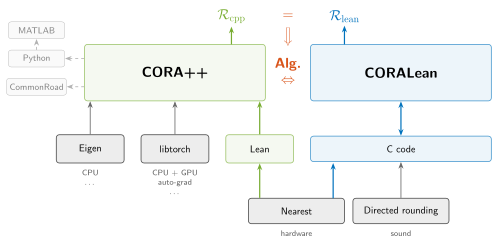

# CORA.cpp

Parts of [CORA](https://cora.in.tum.de), the toolbox for set-based computing, in C++ and Python.
Runs on CPU and GPU, batches automatically, is differentiable. Names are those of MATLAB CORA in
C++ and Python style: `cont_set/zonotope/support_function.cpp` is `@zonotope/supportFunc.m`, and every
operation file names its CORA file ([docs/naming.md](docs/naming.md) has the table).

C++:

```cpp
#include "cora/cora.h"
using namespace cora;

Tensor A({{-0.1, 1}, {-1, -0.1}});                                     // x' = A x
Zonotope X0(Tensor({1, 0}), 0.1 * Tensor::eye(2));                     // center, generators
ReachSet R = LinearSys(A).reach({.initial_set = X0, .t_final = 5.0},   // the problem
                                alg::Standard{.time_step = 0.1});      // the algorithm
Specification spec = Specification::unsafe_set(Tensor({1, 0}), -0.75); // stay out of x1 <= -0.75
bool safe = spec.check(R.time_interval);
plot(R, {0, 1});                                                       // dimensions to show
figure().save("reach.svg");                                            // C++ writes SVG
```

Python:

```python
from cora import Tensor, Zonotope, LinearSys, Specification, eye, plot

A = Tensor([[-0.1, 1], [-1, -0.1]])                                    # x' = A x
X0 = Zonotope(Tensor([1, 0]), 0.1 * eye(2))                            # center, generators
R = LinearSys(A).reach(X0, t_final=5.0, alg="standard", time_step=0.1)
spec = Specification.unsafe_set(Tensor([1, 0]), -0.75)                 # stay out of x1 <= -0.75
safe = spec.check(R.time_interval)
plot(R)                                                                # dims default to (0, 1)
```

## Install

Needs a C++20 compiler and CMake 3.25 or newer, on Linux, macOS or Windows:

```bash
cmake --workflow --preset core        # or: see table below for python, torch, cuda
```

The same in separate steps:

```bash
cmake --preset core
cmake --build --preset core
ctest --preset core
```

| preset | installs |
| --- | --- |
| `core` | eigen |
| `torch` | eigen + torch |
| `torch-cuda` | eigen + torch + cuda |
| `python` | eigen + python + numpy |
| `python-torch` | eigen + python + numpy + torch |
| `python-torch-cuda` | eigen + python + numpy + torch + cuda |

- Eigen is downloaded if it is not installed.
- The Python presets create `.venv` in the project folder and install into it only
  (`scripts/requirements-python.txt`, or `scripts/requirements-python-torch.txt` for torch). They need Python 3.
- Use the package with `.venv`'s Python and `PYTHONPATH=build/python` (Windows: `set PYTHONPATH=build\python`).
- The nightly CI builds `core`, `python` on Linux, macOS and Windows, and `torch`, `python-torch` on Linux only;
  the CUDA presets (CUDA 12.6) are not built there.
- Linux and WSL2 also have `scripts/setup_local.sh` (a conda environment). In VS Code, open an example
  and press `F5`.

## Examples

One file per topic, in [`examples/cpp`](examples/cpp) and [`examples/python`](examples/python):
reachability of linear and nonlinear systems, specifications, backends, batching, GPU, gradients,
learning, conformal prediction, neural network verification, and the CORALean oracle.

MATLAB: [`examples/matlab`](examples/matlab) computes in CORA.cpp and plots with CORA (`toPy`/`fromPy`,
CORA branch `feature/coracpp-python`); it uses the `python` preset and the same Python as MATLAB.

Benchmarks: [`examples/benchmarks`](examples/benchmarks) runs the ARCH-COMP AFF instances of MATLAB CORA in C++ and Python on the same data.

Differences from MATLAB: points are columns `(n, 1)` in C++ (1-D in Python); `R.time_interval[k]`
covers `[k*time_step, (k+1)*time_step]` and `R.time_point[k]` is at `k*time_step` (0-based). Errors
carry CORA's identifiers (`cora::Error`, `cora.errors.WrongValue` for `CORA:wrongValue`); the input
checks can be switched off (`ChecksScope`, `with cora.checks(False):`, CMake `CORACPP_CHECKS=OFF`).

Use it from another CMake project after `cmake --install build --prefix <dir>`:
`find_package(CORA)` and `target_link_libraries(app PRIVATE CORA::cora)`. The design is in
[docs/architecture.md](docs/architecture.md).

## Coverage

How much of CORA this has, and how much of it is checked against CORALean, per CORA method
([the tables](coverage/README.md), generated from the tree and enforced by `ctest`):

<!-- coverage:begin -->
| Group | CORA methods | todo | untested | ported | property | oracle | out of scope | oracle debt |
|---|---|---|---|---|---|---|---|---|
| [contSet](coverage/contSet/) | 908 | 764 | 21 | 15 | 25 | 69 | 14 | 31 |
| [contDynamics](coverage/contDynamics/) | 159 | 144 | 5 | 10 | 0 | 0 | 0 | 7 |
| [hybridDynamics](coverage/hybridDynamics/) | 89 | 89 | 0 | 0 | 0 | 0 | 0 | 0 |
| [nn](coverage/nn/) | 104 | 101 | 1 | 2 | 0 | 0 | 0 | 2 |
| [specification](coverage/specification/) | 224 | 222 | 0 | 2 | 0 | 0 | 0 | 2 |
| [others](coverage/others/) | 212 | 212 | 0 | 0 | 0 | 0 | 0 | 0 |
| **all** | 1696 | 1532 | 27 | 29 | 25 | 69 | 14 | 42 |

9% of the 1682 CORA methods in scope have a source, 7% are tested in C++ and Python, 4% are checked against CORALean; oracle debt 42.
<!-- coverage:end -->

## Connection to CORALean



CORALean can serve as the ground-truth implementation of CORA.
With the oracle set up (`CORACPP_ORACLE`, see [CONTRIBUTING.md](CONTRIBUTING.md)), an algorithm
in C++ is validated exactly against CORALean: the `lean` backend rounds to nearest like the hardware, so
its results match the oracle bit for bit, while the oracle's directed rounding gives the sound enclosure.
The figure's source is [`docs/coralean.tex`](docs/coralean.tex).

[`scripts/competition/`](scripts/competition/README.md) holds the CORA-COMP entry; see
[CONTRIBUTING.md](CONTRIBUTING.md) to work on the library.
